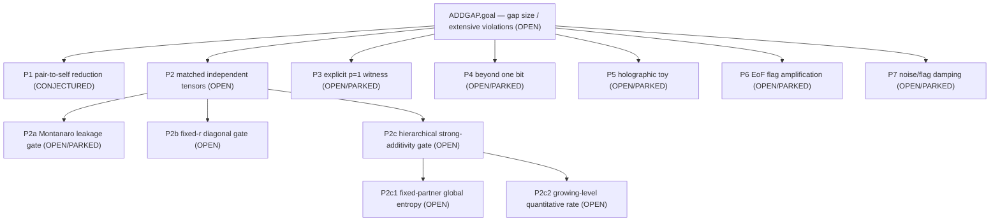

# Size of the Hastings additivity gap — AND/OR proof-search DAG

**Most recent change — 2026-08-29 round-5 hierarchy audit:** fixed-partner entropy additivity, if
proved, would yield a finite-dimensional absolute gap unbounded with hierarchy depth. It does not
by itself yield a gap extensive in the complete channel qubit cost, because the required auxiliary
dimensions may grow arbitrarily fast. A separate growing-level quantitative rate child is now
registered for that stronger conclusion.
Executor layer = codex CLI (lead directive 2026-07-28); Fable 5 = decision layer; reviewer = fresh
codex session, never the proposer.

## How to read this

This file records the **search**, not just the current front. The central question is **OPEN**:
how large can Delta = S_min(N1)+S_min(N2)-S_min(N1 tensor N2) be — in particular do extensive violations exist?

Node kinds: **GOAL / OR-node** (provable by ANY one child), **AND-node** (needs ALL children),
**LEAF** (carries a status). Statuses: `PROVED` · `NUMERICAL` (finite-instance only) ·
`CONJECTURED` · `OPEN` · `REFUTED`. Every REFUTED/dead node carries a one-sentence failure reason,
a disk citation, and a **DEAD** (no repair) / **PARKED** (repairable/deprioritized) tag. Every
PROVED/NUMERICAL node carries its disk citation; where a single-workflow certification exists the
caveat **"(proposer≈checker; independent hostile re-verification owed)"** is attached.

Placement and naming are governed by `../../../research/RESEARCH_STRUCTURE_PROTOCOL.md` (root-level
field folders per the 2026-07-28 lead directive, §10); proof state and reviews by
`../../../research/DAG_PROTOCOL.md`. Shared field papers: `../../literature/` (catalog + one
directory per paper). Validate from the repository root:

```powershell
python tools/proof_dag_check.py --problem additivity-gap
```

## The eight rules, inlined so you cannot miss them

1. **Cite or it didn't happen** — every status write needs a disk cite.
2. **You may not stamp your own work PROVED**, and may not kill a branch to REFUTED alone — both need
   a fresh instance that did not write it and was not told the wanted answer.
3. **Do not over-kill** — deprioritized ≠ REFUTED; use PARKED.
4. **Failures are append-only** — never delete a DEAD node.
5. **CERTIFIED\*/single-author ≠ PROVED** — keep the caveat until an independent process re-verifies.
6. **Review-before-write on every sub-proof node** — NO completion-tier status
   (CERTIFIED\*/PROVED/REFUTED) may be written on ANY proof node until an independent reviewer has
   COMPLETED a review of that node, archived on disk and cited in the status write. Before that:
   status caps at NUMERICAL (evidence tier, command+log+SHA) with an explicit `pending-review:`
   marker, or OPEN/CONJECTURED. Self-audit never licenses CERTIFIED\*.
   (Full text: `../../../research/DAG_PROTOCOL.md` §2 Completion gate + §3 rule 6.)
7. **Review-quality checklist on every review** — every review commission must embed the 7a–7g
   checklist VERBATIM (per-display type audit; identity gates in every regime incl. multiplicity
   c≥2; anchoring ban — derive before reading the proposer's proof; frozen inputs only in reviewed
   scope; standing failure-mode list; value-vs-formula verdicts; every term-of-art resolves).
   A review missing the checklist opens NO completion gate.
   (Full text: `../../../research/DAG_PROTOCOL.md` §3 rule 7.)
8. **Ideas become nodes BEFORE verification; register the whole brainstorm; record outcomes before
   new work; no silent exits** — (8a) no proof/computation/gate/review may be commissioned for an
   approach without a canonical node, and the commissioning prompt MUST cite the node id; (8b) when
   a strategy step generates candidate approaches, ALL of them become nodes at generation time,
   including the ones not pursued (OPEN/PARKED with a one-line reason); (8c) every outcome is
   appended to its node in the session it is read, BEFORE further work is commissioned; (8d) every
   registered idea terminates in an explicit state, never in silence.
   (8e, lead directive 2026-08-07: blueprint at birth, proof at completion) children are
   registered ONLY together with a BLUEPRINT in the parent's node file — the frozen composition
   claim plus an argument sketch of why the pieces compose (sketch licenses composition
   CONJECTURED; bare claim sits at OPEN; no claim = invalid decomposition); when all
   status-propagating children complete, the blueprint must be completed into a full prose or
   Lean composition proof and pass rule-6/7 review before the parent may display any completion
   tier.
   (Full text: `../../../research/DAG_PROTOCOL.md` §3 rule 8.)

## 1. The DAG (mermaid)



## 2. Nested text outline (every node: kind · status)

- `ADDGAP.goal` — GOAL · OPEN (record < log 2 since 2008; HP dichotomy with black-hole microstates; frontier class)
  - `ADDGAP.pair-to-self` — LEAF · CONJECTURED (unreviewed constant-loss direct-sum reduction)
  - `ADDGAP.matched-independent-tensors` — LEAF · OPEN (dimension-first diagonal route active)
    - `ADDGAP.montanaro-gate` — LEAF · OPEN / PARKED (negative scope audit; review pending)
    - `ADDGAP.fixed-r-diagonal-gate` — LEAF · OPEN (global independent-product theorem gate)
    - `ADDGAP.hierarchical-strong-additivity` — LEAF · OPEN (induction conditional on exact child lemma)
      - `ADDGAP.fixed-partner-global-entropy` — LEAF · OPEN (fixed-subspace times random-subspace entropy)
      - `ADDGAP.growing-level-rate` — LEAF · OPEN (extra rate gate for full-size extensivity)
  - `ADDGAP.explicit-witness` — LEAF · OPEN / PARKED (needs bounded ansatz + global certificate)
  - `ADDGAP.beyond-one-bit` — LEAF · OPEN / PARKED (record route, not amplification by itself)
  - `ADDGAP.holographic-toy` — LEAF · OPEN / PARKED (needs a finite certifiable code model)
  - `ADDGAP.ef-flag-amplification` — LEAF · OPEN / PARKED (needs a tensor-stable state ansatz)
  - `ADDGAP.noise-flag-damping` — LEAF · OPEN / PARKED (needs a symbolic two-rate inequality)

