# Zero-capacity boundary of the noisy Werner–Holevo family — AND/OR proof-search DAG

**Most recent change - 2026-08-01 (latest): P15-B landed AND R16-reviewed (LICENSE A,
0 MAJOR) — the P_b2 death point is bracketed to [0.42966287, 0.4297] (width 3.7e-6, R16
U4) with exact-form candidate x_d = 0.42966287… = the root of the REVIEWER-VERIFIED
orthocomplement-stratum identity G*(x) = (1−2x)ln x + x ln(2−x) − (1−x)ln(1−x) − (1−x)ln 2
(R16 U1); the violation side is ANALYTIC pending one review — the decision-layer
monotonicity lemma (`WHGAP_P15B_MONOTONICITY_LEMMA_20260801.md`, G*′ ≥ ln 6 + 2/3,
pending-review) gives P_b2 fails at EVERY x < x_d; the first tensorization test is a
bounded null with a structural reduction (W₂ additivity ⟹ product-σ 2-copy ⟺ 1-copy).**
Candidate P15 domain sharpens to (x_d, 1/2); x_death = x_d exactly ⟺ F1
(stratum-global-minimality above x_d), the remaining proof obligation. Graph unchanged (no
new nodes/edges; P15 stays OPEN). Same day: LEAN-5 WP-H executed (complex-Hermitian
entropy glue — Trust residual (b) discharged at 245 axiom-clean declarations, freeze 8/8
unchanged; hach′ proved EQUIVALENT to hach, the identification leaving the trust boundary)
with R15 review in flight; commission `WHGAP_COMMISSION_LEAN5_P15B_20260801.md`. Between
LEAN-1 and this entry the Lean mirror grew through LEAN-2/3/4 + reviews R11–R14 (232
declarations, 0 sorry, axioms clean; full charpoly for all real x; rank C_{1/2} = 3; the
729-entry channel→defect-Choi bridge; complex output charpolys; paper v5.3) — recorded on
the nodes and in `Trust.lean`, header updated here only now (sync miss, corrected). Earlier:

**2026-07-30: LEAN-1 landed — the DAG has a machine-checked
mirror (`proof-dag/lean/`, 12 modules, build green, 0 sorry, axioms clean).** Module names
= node ids; import graph = the propagating skeleton; frozen Claims + SHA-256 in every
docstring (drift-checkable). PROVED OUTRIGHT in Lean: the P14 flagship scalar core
(f_pos, the ε = t = ε_c/2 argument-coincidence — as a rational identity in r, stronger
than commissioned — and Δ(x) > 0 on (0,1/2)); the GOAL's union-assembly composition
({x ∈ (0,1) : Q x = 0} = [1/2,1) ∪ S from the three child Claims); P6's gap/threshold/
strict-violation identities; P2's forcing identities + eigenvalue sign branches; P9's
d1_sign + witness extraction. T1 compositions checked for P4 ⟸ P2 and P3 ⟸ P9 against
the minimal CapacityInterface (3 cited fields). Honesty layer: unrepresentable steps are
explicit hypothesis parameters (hbridge, hexp, hHolds/hFails, hsq), never sorry; P13 is
stated, asserted nowhere. Evidence tier NUMERICAL `pending-review:` — the fresh §7.10
statement-fidelity review is the completion gate (commissioned next). Executor caught a
decision-layer commission defect (degenerate self-test point, 0 = 0). Report:
`artifacts/whgap_lean_t1t2_20260730.md`. Earlier:

**2026-07-30: protocol-compliance restructure — edges
normalized to obligations, composition proofs written, main conclusions re-audited;
P16 REFUTED/DEAD (R10); P15-A completed-on-disk (record corrected same day).**
Per the updated `DAG_PROTOCOL.md` §1: children now record ONLY status-propagating inputs,
each with a composition block on the parent. New propagating skeleton:
G ⟸ {P3 ⟸ P9, P4 ⟸ P2, P13}; root-level companion theorem P6 ⟸ P2; all other nodes
`related`. Composition proofs (all pre-existing and reviewed, now named as such): G =
NEW inline union assembly (OPEN rel P13); P3 = N1' Thm 8.1 (R5d); P4 = the R3 assembly
note; P6 = paper §5 (R5b). **Post-normalization audit: all four headline theorems
survive** (Q=P=0 on [1/2,1); x_B = 1/2; Q>0 on (0,2/5); {x:P=0} = [1/2,1)) with the
scoped-input rels displayed; one residual item — paper Lemma 4.1 (x=1) has no dedicated
rule-7 review (endpoint independently covered by RK24 cite-only). P16
`direction-restricted-order` = REFUTED/DEAD (P16-A executor kill + R10 confirmation with
two STRENGTHENING corrections: vacuity for CI pairs as an exact theorem, certified strip
violations at 0.42/0.45/0.46, tensor instability; scope = isotypic-type restrictions).
Lean phase per §7 follows (proof-dag/lean/, DAG-mirroring). Earlier:

**2026-07-30: the PRIVATE-capacity half is CLOSED, and the
restricted-order programme is settled in the large (but its dichotomy was REFUTED).**
P12-A (outcome THEOREM) + R8 (FINDINGS: 3 scope MAJORs, mathematical core confirmed in
full by an independent route). New node **`WHGAP.private-boundary` (P14) = PROVED**:
\[ P^{(1)}(\Lambda_x)\;\ge\;\frac{(1-2x)(1-x)}{2-3x}\,f\!\Big(\frac{1-2x}{\sqrt2\,(1-x)}\Big)\;\ge\;\frac{(1-2x)^3}{2(1-x)(2-3x)}\;>\;0,\qquad x<\tfrac12, \]
\(f(s)=(1+s)\log(1+s)+(1-s)\log(1-s)\), attained by the symmetric two-point ensemble
\(\{\tfrac12:\rho_\varepsilon\pm tX\}\) at \(\varepsilon=t=\varepsilon_c/2\), where the two
Holevo \(f\)-arguments coincide EXACTLY so \(\Delta=(b-e)f(s^*)\) with \(b-e=\varepsilon(1-x)>0\)
— no perturbation theory, no series bounds. Hence **\(\{x\in(0,1):P(\Lambda_x)=0\}=[1/2,1)\)
exactly** (closed interval CERTIFIED\*). The private boundary therefore COINCIDES with the
cRE/cBKM order boundary, and every order class implying \(P^{(1)}=0\) is **FALSE** below
1/2 (less noisy, cRE, cBKM, signed lifts, \(\alpha\ge1\) Rényi, and P12's own
"anchored less-noisy"). Purity knob PROVED: pure ensembles ⟺ \(Q^{(1)}=0\), all ensembles
⟺ \(P^{(1)}=0\). **R8 refuted the decision layer's "no room" dichotomy as
non-exhaustive** — two classes survive and are registered: `WHGAP.pure-anchor-order` (P15)
and `WHGAP.direction-restricted-order` (P16). Literature: RK24/RK25 say nothing about
private capacity here; ZW covers only x=1/2 — the theorem is new. Review:
`artifacts/whgap_r8_review_20260730.md`. Earlier:

**2026-07-30: R7 review of P13-B applied — exact package
CERTIFIED\*, headline CORRECTED, bounded null reinforced.** R7 (FINDINGS: 2 interpretive
MAJORs, all exact numbers independently confirmed) corrected the previous header's two
claims: the type-E entangled base point's threshold is
\(x^*_E=0.391297769\ldots\) (root of \(19x^4-21x^3-14x^2+28x-8\)) — **strictly below
2/5** — and the 2-copy first-order coefficient is strictly SUBADDITIVE (per channel use
0.0576 < d₁ = 0.0985 at 7/20), so "the 2/5 threshold reappears at n=2" holds only via
the embedded n=1 product witness (the (5x−2) factors live there, not in the entangled
layer). CERTIFIED\* (R7 §7 wording): S2 identity PROVED symbolically; (r, m_B, m_E)
x-independence PROVED; exact strip zeros at ~7 orbits; the two symbolic-in-x interval
certificates. Sweep = sound NUMERICAL bounded null on the m_B=1/product strata; the
positive-dimensional m_B≥2 remainder is UNSEARCHED; \(P_3\)-completeness CONJECTURED.
New (R7 m4, NUMERICAL): \(\dim\ker D_\Psi=1\) at every tested strip point ⟹ the generic
n=2 balanced layer appears EMPTY (sole exception: iso-product exactly at 2/5). Entangled
base points die EARLIER than the product witness — the onset conjecture's null evidence
is strengthened, not weakened. Review:
`artifacts/whgap_r7_review_20260730.md`. Earlier (header claims corrected above):

**2026-07-30: P13-A stratum-exhaustion Theorem PROVED
(R6 review, LICENSE A, 0 MAJOR) — the n = 1 first-order landscape is complete.**
For every pure \(\psi\) with \(\tau(\psi)=|\psi^T\psi|>0\) and every state
\(\phi\neq P_\psi\): the B-side output is full rank (block det \(=x(1-x)\tau^2/2\)),
\(\ker\Lambda^c(P_\psi)=\mathrm{span}\{(0,\bar\psi)\}\),
\(K^\dagger K=(x/2)(\mathbbm{1}-P_\psi)\) exactly (exceptional set EMPTY), so
\(w_E=(x/2)(1-\langle\psi|\phi|\psi\rangle)>0\) and
\(I_c=-w_E\,\epsilon\log(1/\epsilon)+O(\epsilon)<0\). Combined with the R5c isotropic
closed form: **at n = 1 the pure-base first-order mechanism yields witnesses exactly for
x < 2/5, and only on the isotropic stratum** (R6 wording; nothing establishes
\(Q^{(1)}=0\) on [2/5,1/2)). P13 obligation (b) closed at the first-order layer;
first-order (c) closed off the isotropic stratum; P13 stays CONJECTURED. Note:
`notes/WHGAP_P13A_STRATUM_EXHAUSTION_20260730.md`; review:
`artifacts/whgap_r6_review_20260730.md`; logs:
`artifacts/logs_whgap_p13a_20260730/`. Earlier:

**2026-07-30: R5 batch reviews applied — Q>0 PROVED on all
of (0, 2/5); order boundary PROVED at exactly 1/2; open strip = [2/5, 1/2).**
Five fresh Opus instances (commission
`notes/WHGAP_REVIEW_COMMISSION_R5_20260729.md`): **R5b LICENSE A** — the lead's
BKM-necessity witness chain is PROVED (own 57-gate rebuild; exact finite-eps threshold
\(\epsilon_c(x)=2(1-2x)/(2-3x)\); symbolic coverage of all \(x\in(0,1/2)\)), so with
P2/P4 the cBKM/cRE domination set is exactly \([1/2,1)\):
`WHGAP.order-boundary` = **PROVED** (x_B = 1/2; phase classification
cBKM ⟺ cRE ⟺ signed-lift ⟺ x ∈ [1/2,1)). **R5a FINDINGS** (3 MAJOR, substantive
negativity independently confirmed) re-scopes the P6 numerical record (bisection points
numerical-only; d_R≥2 columns void; no-violation resolution ~1e-7). **R5c LICENSE A** —
the isotropic weight-operator closed form \(d_1=(1-x)(2-5x)/(2-x)\) PROVED symbolically,
with a constructive SO(3) orbit-transport proof and unconditional localization of the
superseded script's sign defect. **E-N1 + R5d LICENSE A** — the \(\epsilon\log\epsilon\)
expansion lemma (explicit remainder \(C(x)\), uniform in \(\phi,\psi\)) and **Theorem
\(Q(\Lambda_x)>0\) for ALL \(x\in(0,2/5)\)** are PROVED unconditionally:
`WHGAP.no-ascent-hierarchy` = **CERTIFIED\*** (n=1 isotropic layer PROVED; general
hierarchy CONJECTURED), `WHGAP.qpositive-onset` PROVED tier extends to (0, 2/5)
(subsuming (0, x_1) and 783/2000), and the onset conjecture x_D = 2/5 is registered as
new node `WHGAP.onset-two-fifths` (P13, CONJECTURED, rule 8b). Reports:
`artifacts/whgap_r5{a,b,c,d}_review_20260729.md`; lemma note:
`notes/WHGAP_N1PRIME_EXPANSION_LEMMA_20260729.md`; reviewer scripts/logs:
`artifacts/logs_whgap_r5_20260729/`. Earlier:

**2026-07-29: P9b stopped at repaired gate G0'.**
The parameterized isotropic spectra, three random checks, the exact
\(\tau\)-interpolation including the prior P9 failure sample, and five
unbalanced epsilon fits passed. The required distinct balanced directions do
not exist at \(x=9/20\): exactly,
\(D_\psi=\operatorname{diag}(-99/620,-11/124,0)\) in the canonical isotropic
basis, so balance forces \(\phi=P_\psi\). Under pre-registered G2(c),
S1'/S2'/S3' were not entered; `WHGAP.no-ascent-hierarchy` stays CONJECTURED
with `pending-review:`. Artifact:
`artifacts/whgap_p9b_noascent_20260729.md`. Earlier same day: P9 E1 failed G0
because the fixed pure-output spectrum was false for generic complex inputs and
the stated support constraint left no distinct kernel-avoiding state in four
generic tests; E2 found no direction-valid one- or correlated two-copy
filtered-hashing rate above \(10^{-10}\) bits/use in the strip (273 and 36
trials per point). Artifact: `artifacts/whgap_p9_necessary_20260729.md`. Earlier:

**2026-07-29: P6 cBKM scan completed; order-boundary is
NUMERICAL pending review; relaxed-lift status unchanged.**
P6 certified cBKM violations on the entire prescribed rational grid through 499/1000,
with a bounded-search bracket [7999/16000,1/2] of width 1/16000 and clean calibration
floors at 1/2 and 11/20. D2 passed 200 criterion-(W) stress instances; the true-adjoint
complex covariant ansatz has residual real dimension six, recovers the real certificates
at 13/25 and 1/2, and found no two-sided feasibility below 1/2 under 100 restarts per
point. `WHGAP.order-boundary` is NUMERICAL with `pending-review:`; `WHGAP.relaxed-lift`
remains CONJECTURED. Artifact: `artifacts/whgap_p6_relaxation_20260729.md`; logs, JSON,
scripts, and SHA-256 metadata are archived. Earlier:

**2026-07-29: P5 paper-grade derivation package completed; all statuses unchanged.**
The exposition-only P5 campaign for `WHGAP.signed-lift-extension` passed V1-V5 and produced
`artifacts/whgap_p5_derivation_package_20260729.md` plus exact machine JSON, logs, scripts,
and SHA-256 metadata. It supplies the paper-audit-requested entrywise 15-delta formula (verified
on all 729 entries), forcing computations, integer spin bases and Gram pencils, forced-point
rank-one spectrum derivation, and exact congruence data at 26/51, 4/7, and 3/4. The generic
direct symbolic charpoly hit the commissioned 15-minute fallback threshold; the exact
SO(3)-isotypic pencil proof and five exact general-chart direct charpoly checks passed.
This is exposition data only: `WHGAP.signed-lift-extension` remains CERTIFIED*, the GOAL remains
OPEN, and no status field, Mermaid label/class, outline status, or index row changed. Earlier:

**2026-07-29: P3 R4-reviewed → CERTIFIED\*; Q>0 PROVED on (0, x_1) plus the 783/2000 witness.**
The fresh-session R4 review (`artifacts/whgap_p3_review_20260729.md`) passed with two MINORs
(the artifact's `Ic(pi,3/4) = -1/4` display corrected to `log2(3)-2`; manifest bookkeeping
timing) and opened PROVED for the exact package — Q(Lambda_x) > 0 for every x in (0, x_1),
x_1 = 0.390910232076... bracketed to 1e-31, three interval certificates, and the exact
rank-two witness at x = 783/2000 > x_1 (neighborhood existence, endpoints open) — plus
CERTIFIED\* for the S1/S3 numerical package. The decision layer applied the licensing:
P3 = CERTIFIED\*; the exact onset boundary and the strip up to 1/2 remain OPEN. A new idea is
registered on the node (near-pure epsilon-expansion for a closed-form single-letter onset).
Earlier:

**2026-07-29: P3 execution (superseded by the review above).**
The commissioned P3 executor passed G0, completed 2,000 S1 restarts, derived the two-sector S2
Hessian threshold `x_H=0.4162325706014828112675191458355...>x_1`, and finished the capped S3
probe with a bounded null. The decisive G2(b) result is a rational rank-two input at
`x=783/2000=0.3915>x_1` whose exact output/environment spectra give a positive mpmath-interval
coherent-information lower bound. `WHGAP.qpositive-onset` is now NUMERICAL with
`pending-review:`; the parent goal stays OPEN and the exact onset boundary remains unresolved.
Artifact: `artifacts/whgap_p3_qonset_20260729.md`; logs/hashes:
`artifacts/logs_whgap_p3_20260729/`. Earlier:

**2026-07-28: external review PASS + paper draft v1 shipped.**
The lead-run ChatGPT-Pro hostile review returned PASS (no fatal flaw) and contributed the
closed-form defect spectrum, explicit forcing vectors, and the x=1 minimal-complement
self-complementarity (all decision-layer machine-confirmed:
`artifacts/whgap_external_review_chatgpt_20260728.md`), extending the capacity theorem to the
CLOSED interval [1/2, 1]. The 8-page manuscript draft (`paper/main.tex|pdf`) incorporates all
four external revision requirements; author list awaits the lead. Earlier same day:

**2026-07-28 P4 PROVED (R3): the (1/2, 4/7) gap is CLOSED.** The
fresh-session R3 review (`artifacts/whgap_p4_review_20260728.md`; outline hash-frozen before
reading, PDF statement-level cross-checks, exact sympy gates) passed the assembly note with
three wording-level MINORs (fixed in the note's dated revision) and opened the completion gate:
**Theorem at PROVED — Q(Lambda_x) = P(Lambda_x) = 0 for every x in [1/2, 1) at every
blocklength** (HRSF22-via-ZW provenance note carried); Corollary {x : Q=0} ⊇ [1/2, 1] at
CERTIFIED\* (RK24 endpoint cite-only); the gap-closure substatement lies inside the PROVED
scope with no RK24 dependency. The decision layer applied the licensing verbatim to
`WHGAP.zero-capacity-application`. `WHGAP.goal`'s second clause (close the gap) is resolved;
the GOAL stays OPEN only for the full {x : Q=0} determination — remaining frontier x < 1/2
(P3, OPEN). Earlier same day: R2 opened PROVED for the covariant lift region [1/2,1) (P2
CERTIFIED\*); P2 exact execution; P1 CERTIFIED\* narrow ("4/7 numerically tight"); P3
registered. Executor layer = codex CLI; Fable 5 = decision layer; reviewers = fresh codex
sessions, never the proposer.

## How to read this

This file records the **search**, not just the current front. The central question is **OPEN**:
determine {x : Q(Lambda_x)=0} for Lambda_x(X) = (1-x)X + (x/2)(Tr(X)1 - X^T) on qutrits; close x in (1/2, 4/7).

Node kinds: **GOAL / OR-node** (provable by ANY one child), **AND-node** (needs ALL children),
**LEAF** (carries a status). Statuses: `PROVED` · `NUMERICAL` (finite-instance only) ·
`CONJECTURED` · `OPEN` · `REFUTED`. Every REFUTED/dead node carries a one-sentence failure reason,
a disk citation, and a **DEAD** (no repair) / **PARKED** (repairable/deprioritized) tag. Every
PROVED/NUMERICAL node carries its disk citation; where a single-workflow certification exists the
caveat **"(proposer≈checker; independent hostile re-verification owed)"** is attached.

Placement and naming are governed by `../../../research/RESEARCH_STRUCTURE_PROTOCOL.md` (root-level
field folders per the 2026-07-28 lead directive, §10); proof state and reviews by
`../../../research/DAG_PROTOCOL.md`. Shared field papers: `../../literature/` (catalog + one
directory per paper). Validate from the repository root:

```powershell
python tools/proof_dag_check.py --problem werner-holevo-gap
```

## The eight rules, inlined so you cannot miss them

1. **Cite or it didn't happen** — every status write needs a disk cite.
2. **You may not stamp your own work PROVED**, and may not kill a branch to REFUTED alone — both need
   a fresh instance that did not write it and was not told the wanted answer.
3. **Do not over-kill** — deprioritized ≠ REFUTED; use PARKED.
4. **Failures are append-only** — never delete a DEAD node.
5. **CERTIFIED\*/single-author ≠ PROVED** — keep the caveat until an independent process re-verifies.
6. **Review-before-write on every sub-proof node** — NO completion-tier status
   (CERTIFIED\*/PROVED/REFUTED) may be written on ANY proof node until an independent reviewer has
   COMPLETED a review of that node, archived on disk and cited in the status write. Before that:
   status caps at NUMERICAL (evidence tier, command+log+SHA) with an explicit `pending-review:`
   marker, or OPEN/CONJECTURED. Self-audit never licenses CERTIFIED\*.
   (Full text: `../../../research/DAG_PROTOCOL.md` §2 Completion gate + §3 rule 6.)
7. **Review-quality checklist on every review** — every review commission must embed the 7a–7g
   checklist VERBATIM (per-display type audit; identity gates in every regime incl. multiplicity
   c≥2; anchoring ban — derive before reading the proposer's proof; frozen inputs only in reviewed
   scope; standing failure-mode list; value-vs-formula verdicts; every term-of-art resolves).
   A review missing the checklist opens NO completion gate.
   (Full text: `../../../research/DAG_PROTOCOL.md` §3 rule 7.)
8. **Ideas become nodes BEFORE verification; register the whole brainstorm; record outcomes before
   new work; no silent exits** — (8a) no proof/computation/gate/review may be commissioned for an
   approach without a canonical node, and the commissioning prompt MUST cite the node id; (8b) when
   a strategy step generates candidate approaches, ALL of them become nodes at generation time,
   including the ones not pursued (OPEN/PARKED with a one-line reason); (8c) every outcome is
   appended to its node in the session it is read, BEFORE further work is commissioned; (8d) every
   registered idea terminates in an explicit state, never in silence.
   (8e, lead directive 2026-08-07: blueprint at birth, proof at completion) children are
   registered ONLY together with a BLUEPRINT in the parent's node file — the frozen composition
   claim plus an argument sketch of why the pieces compose (sketch licenses composition
   CONJECTURED; bare claim sits at OPEN; no claim = invalid decomposition); when all
   status-propagating children complete, the blueprint must be completed into a full prose or
   Lean composition proof and pass rule-6/7 review before the parent may display any completion
   tier.
   (Full text: `../../../research/DAG_PROTOCOL.md` §3 rule 8.)

## 1. The DAG (mermaid)

```mermaid
flowchart TD
  G["WHGAP.goal — zero-capacity boundary of Lambda_x (OPEN; resolved except on [2/5,1/2))"]
  P3["WHGAP.qpositive-onset — Q>0 piece (AND; CERTIFIED*; imported Thm PROVED: Q>0 on (0,2/5) via P9's lemma, R5d)"]
  P4["WHGAP.zero-capacity-application — Q=P=0 on [1/2,1) (AND; PROVED, R3; gap (1/2,4/7) CLOSED)"]
  P13["WHGAP.onset-two-fifths — is x_D = 2/5 the exact onset? (CONJECTURED)"]
  P2["WHGAP.signed-lift-extension — unique covariant lift family (CERTIFIED*; region theorem at R2-PROVED scope)"]
  P9["WHGAP.no-ascent-hierarchy — N1' machinery (CERTIFIED*; expansion lemma + closed form at R5c/R5d-PROVED scope)"]
  P6["WHGAP.order-boundary — x_B = 1/2 exactly (AND; PROVED, R5b)"]
  P14["WHGAP.private-boundary — {x: P=0} = [1/2,1) exactly (PROVED, R8)"]
  P1["WHGAP.antideg-boundary — 4/7 numerically tight (CERTIFIED*)"]
  P7["WHGAP.relaxed-lift — criterion W (CONJECTURED)"]
  P8["WHGAP.more-capable-route — (OPEN, PARKED)"]
  P10["WHGAP.choi-distillation-necessary — (NUMERICAL; pending-review)"]
  P11["WHGAP.order-converse — reg-vs-complete gap frame (OPEN)"]
  P12["WHGAP.restricted-order — no-go settled in the large; construction half OPEN"]
  P15["WHGAP.pure-anchor-order — surviving candidate (OPEN)"]
  P16["WHGAP.direction-restricted-order — (REFUTED, DEAD: R10)"]
  %% solid = status-propagating (composition proofs on the parent nodes)
  G --> P3
  G --> P4
  G --> P13
  P3 --> P9
  P4 --> P2
  P6 --> P2
  %% dashed = related context (no status propagation)
  G -.- P1
  G -.- P6
  G -.- P14
  G -.- P7
  G -.- P8
  G -.- P10
  G -.- P11
  G -.- P12
  G -.- P15
  G -.- P16
```



## 2. Nested text outline (every node: kind · status; indentation = status-propagating children; flat list at the end = related-only nodes)

**Edge normalization 2026-07-30 (protocol update "edges are obligations"):** children are
now ONLY status-propagating inputs with composition proofs on the parent; everything else
is `related`. The propagating skeleton is
G ⟸ {P3 ⟸ P9, P4 ⟸ P2, P13} plus the root-level theorem P6 ⟸ P2.

- `WHGAP.goal` — GOAL · OPEN (composition = inline union assembly on the node: the three
  children partition (0,1); determination complete iff P13 resolves; displayed as
  "resolved except on [2/5, 1/2)")
  - `WHGAP.qpositive-onset` — AND · CERTIFIED\* (composition = Thm 8.1 of the N1' note,
    R5d-PROVED, consuming only the R5c/R5d-reviewed subset of P9: **Q>0 on ALL of
    (0, 2/5)**, subsuming the in-node R4 package for (0,x_1) + the 783/2000 witness; the
    node star marks the residual exact-onset scope)
    - `WHGAP.no-ascent-hierarchy` — LEAF · CERTIFIED\* (R5c + R5d LICENSE A: n=1
      isotropic layer PROVED — closed form d_1=(1-x)(2-5x)/(2-x) + SO(3) transport +
      expansion lemma with explicit remainder; general hierarchy n>=2 / tau≠0 / balanced
      layer stays CONJECTURED — the star marks exactly that broader scope)
  - `WHGAP.zero-capacity-application` — AND · PROVED (composition = the R3-reviewed
    assembly note, consuming the R2-PROVED-scope region subclaim of P2 + the ZW/BGSW25/
    HRSF22/LSD interfaces: Theorem Q=P=0 on [1/2,1) at every blocklength; Corollary
    [1/2,1] at CERTIFIED\* — RK24 endpoint cite-only)
    - `WHGAP.signed-lift-extension` — LEAF · CERTIFIED\* (R2 claims 1–8 PASS; PROVED tier
      for the feasible-region theorem at the unique lift + three exact certificates +
      twirling ingredients; the star marks the delegated capacity clause and the
      ansatz-scope caveat)
  - `WHGAP.onset-two-fifths` — LEAF · CONJECTURED (P13: is x_D = 2/5 the exact onset?
    PROVED on both sides; P13-A stratum exhaustion PROVED (R6); P13-B n=2 exact package
    CERTIFIED\* (R7); remaining: isotropic higher-order layers at/above 2/5, m_B>=2
    stratum remainder, n>=3)
- `WHGAP.order-boundary` — AND · PROVED, root-level companion theorem (composition =
  paper §5 + R5b: x_B = 1/2 exactly; child = P2 for the holding side; related to G, not
  propagating into the Q-determination)
    - (child) `WHGAP.signed-lift-extension` — shared with P4 above

Related-only nodes (no status propagation; full records in their canonical files):
- `WHGAP.antideg-boundary` — LEAF · CERTIFIED\* (narrow scope: "4/7 numerically tight
  (1e-6)"; exact boundary GAP)
- `WHGAP.private-boundary` — LEAF · **PROVED** (P14, R8: {x : P=0} = [1/2,1) exactly,
  closed interval CERTIFIED\*; companion determination — the goal's claim is about Q)
- `WHGAP.relaxed-lift` — LEAF · CONJECTURED (criterion W; below-1/2 reach moot: the order
  itself breaks below 1/2)
- `WHGAP.choi-distillation-necessary` — LEAF · NUMERICAL (`pending-review:`)
- `WHGAP.order-converse` — LEAF · OPEN (reg-vs-complete gap frame; covariance-collapse
  question — the live frontier after the P12/P15/P16 outcomes)
- `WHGAP.restricted-order` — LEAF · OPEN (no-go half settled in the large; construction
  half open through P15)
- `WHGAP.pure-anchor-order` — LEAF · OPEN (P15: the one surviving restricted-order
  candidate; strictness at 2/5 R9-reviewed; P15-B + R16 LICENSE A: death point bracketed
  [0.42966287, 0.4297] with exact-form candidate x_d = root of G*, violation side analytic
  modulo a monotonicity lemma; first tensorization test bounded null; F1 stratum-minimality
  = the remaining proof obligation) [outline entry corrected 2026-08-01, R16 m6 — it
  previously still read "P15-A not executed", contradicting the header]
- `WHGAP.direction-restricted-order` — LEAF · REFUTED · DEAD (P16, R10: vacuous for CI
  pairs [exact theorem], false in the strip [certified at 0.42/0.45/0.46], tensor-unstable;
  scope = isotypic-type restrictions D1–D4)
- `WHGAP.more-capable-route` — LEAF · OPEN · PARKED (tensorization = the regularization
  problem)

